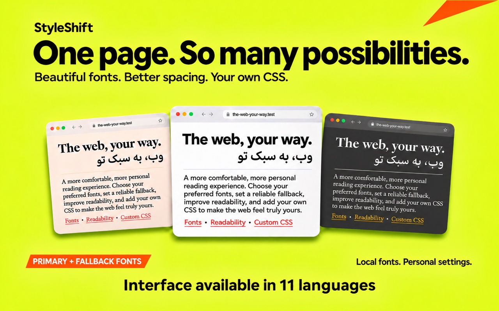
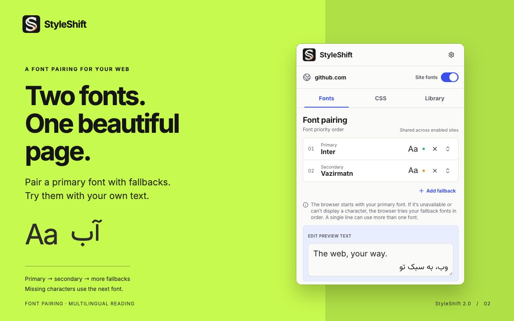

<div align="center">
  
</div>

<hr />

<div align="center">

[](LICENSE)
[](public/manifest.json)
[](package.json)
[](vite.config.ts)
[](https://chromewebstore.google.com/detail/styleshift/mcaoegkknaepofhmlljnemngbkemmkea)

</div>

**StyleShift** is a Chrome extension that lets you customize fonts, typography, and CSS on websites. Build one ordered font stack that is shared across enabled sites, then control font and CSS enablement independently for each site. Pick bundled fonts, use locally available family names, or upload your own. No font, icon, or anything else is fetched from a remote host.

## Features

- **Ordered font pairing** 🔤 — choose a primary, secondary, and further fallbacks in CSS order. The stack is shared across enabled sites; the per-site switch decides where it is injected.
- **One-click site shortcuts** ⚡ — pre-activated toggles for 27 popular sites, ready to enable in one click, with icons bundled in the extension.
- **Code font** 🖋️ — pick one monospace font for code blocks; JetBrains Mono ships bundled (and is what the CSS editor itself uses).
- **Typography controls** 🔡 — line height, letter spacing, font weight, and an enlarge-only minimum font size (via Chrome's own `fontSettings` preference).
- **Custom CSS editor** 🎨 — CodeMirror-powered editor with CSS syntax highlighting, autocomplete, bracket matching, and inline error marks; format, save, remove, reset, and copy per site, with a per-site apply toggle. Also available full-size on the options page.
- **Global CSS** — one stylesheet applied on every site, independent of and layered under any per-site CSS.
- **Subdomain inheritance** — a site's settings automatically apply to its subdomains, with a per-site opt-out and a one-click reset back to inherited.
- **Settings export/import & site manager** 📦 — back up or move your settings as a JSON file, and view/edit/delete every site you've customized from the options page.
- **Persistent, per-hostname settings** 💾 — everything is stored in `chrome.storage.local` and re-applied automatically on page load/navigation.
- **Keyboard shortcut** ⌨️ — toggle fonts for the current site without opening the popup (`Alt+Shift+S` by default).
- **Separate controls** — the popup header toggles fonts for the current site. Settings contains the master StyleShift switch, while the CSS view keeps its own site/global CSS controls.
- **Dark mode** 🌓 — follows the OS by default, with a Light/Dark/System override in Settings.
- **Localized UI** 🌍 — the popup and options page support English, Spanish, French, German, Brazilian Portuguese, Arabic, Simplified Chinese, Traditional Chinese (Taiwan), Japanese, Korean, and Persian, including RTL layouts. StyleShift follows Chrome’s display language where supported, falls back to English, and remembers a language chosen in Settings.
- **Fully offline** 🔒 — all fonts and icons are bundled or user-supplied; the extension makes no network requests at all.

## Install

**[Get StyleShift on the Chrome Web Store](https://chromewebstore.google.com/detail/styleshift/mcaoegkknaepofhmlljnemngbkemmkea)**

## Quick Start (from source)

```bash
npm install
npm run build
```

Then load the extension in Chrome:

1. Open `chrome://extensions`.
2. Enable **Developer mode** (top right).
3. Click **Load unpacked** and select the `dist/` folder.
4. Pin StyleShift and click its icon on any site to start customizing fonts and CSS.

## Navigation and scope

The popup has three tabs: **Fonts** for the shared ordered font pairing, code font and typography; **CSS** for separate This site / All sites drafts; and **Library** for bundled and uploaded fonts. The gear opens preferences and management links. Manage sites opens the options page, whose sidebar contains Sites, Global CSS, Font library, Settings and About.

The secondary font supplies glyphs missing from the primary; fonts are not routed by language. Font and typography edits save automatically. CSS uses an explicit Save button; drafts survive tab/scope navigation while the popup remains open. Closing the popup ends unsaved drafts. The full editor opens the last saved stylesheet and warns when a popup draft is unsaved.

Site font, site CSS and master StyleShift switches have distinct scopes. A site's own settings override inherited settings; resetting a site restores inheritance. The font stack and code font remain shared across enabled sites. Minimum font size is Chrome's browser-wide setting.

<div align="center">
  
</div>

## Tech Stack

- **React + TypeScript + Vite** — popup, settings, and editor pages.
- **Chrome Extension Manifest V3** — `activeTab`, `scripting`, `storage`, `unlimitedStorage`, `fontSettings` permissions, `<all_urls>` host permission.
- **Tailwind CSS** — UI styling.
- **Vitest** — unit tests.

## Project Structure

```
src/
  popup/          Popup UI — ordered font pairing, typography, CSS, and library
  options/        Options page — sites, global CSS, font library, preferences, backup
  css-editor/      CodeMirror-powered CSS editor, shared by the popup and options page
  content/         Content script — reads storage, injects font/CSS on load
  background/      Service worker — triggers re-injection, handles the keyboard shortcut
  shared/          Storage schema, injection logic, font catalogs, i18n, theme, backup
scripts/build-extension.mjs   Build step for the content script & service worker
public/manifest.json          Extension manifest
```

## Development

```bash
npm run dev      # Vite dev server for the popup/editor/settings pages
npm run build    # Production build -> dist/
npm run package  # Build + zip an upload-ready release/styleshift.zip
npm run test     # Run unit tests with Vitest
npm run lint     # ESLint
npm run format   # Prettier
```

See [PRIVACY.md](PRIVACY.md) for the privacy policy — no data leaves your
device.

## Storage Schema

Settings are stored in `chrome.storage.local`. Shared stacks use reserved keys and determine both popup selection and page styling. When those keys are absent, text keeps the website's font and code uses JetBrains Mono; an explicitly empty stack disables its override. Legacy hostname font fields remain stored for backup compatibility but do not select or populate a shared stack. Older backup imports follow the same rules: Merge keeps shared keys omitted from the file, while Replace removes them and restores these defaults.

```json
{
  "__styleshift_font_stack__": ["Inter", "Roboto"],
  "__styleshift_mono_font_stack__": ["JetBrains Mono"],
  "example.com": {
    "fontFamily": "'Roboto', sans-serif",
    "monoFontFamily": "'JetBrains Mono'",
    "fontEnabled": true,
    "cssEnabled": true,
    "customCSS": "body { background: #000; }",
    "includeSubdomains": true
  }
}
```

## Contributing

Issues and pull requests are welcome — bug fixes, new pre-activated sites, translations, or general cleanup.

## Author

**Amir Meimari** — [amirmeimari@gmail.com](mailto:amirmeimari@gmail.com)

## License

Distributed under the MIT License. See [LICENSE](LICENSE) for more information.

### Bundled fonts

The fonts in `public/fonts/library` and `public/fonts/ui` are redistributed
under their own licenses, not StyleShift's:

| Font | License |
| --- | --- |
| JetBrains Mono | SIL OFL 1.1 — [`JetBrainsMono-OFL.txt`](public/fonts/library/JetBrainsMono-OFL.txt) |
| Inter, Lato, Open Sans, Poppins | SIL OFL 1.1 |
| Roboto | Apache License 2.0 |
| Nunito Sans, Vazirmatn | SIL OFL 1.1 |

Only JetBrains Mono currently ships its license text alongside the font files;
the others should get the same treatment before the next store release.
